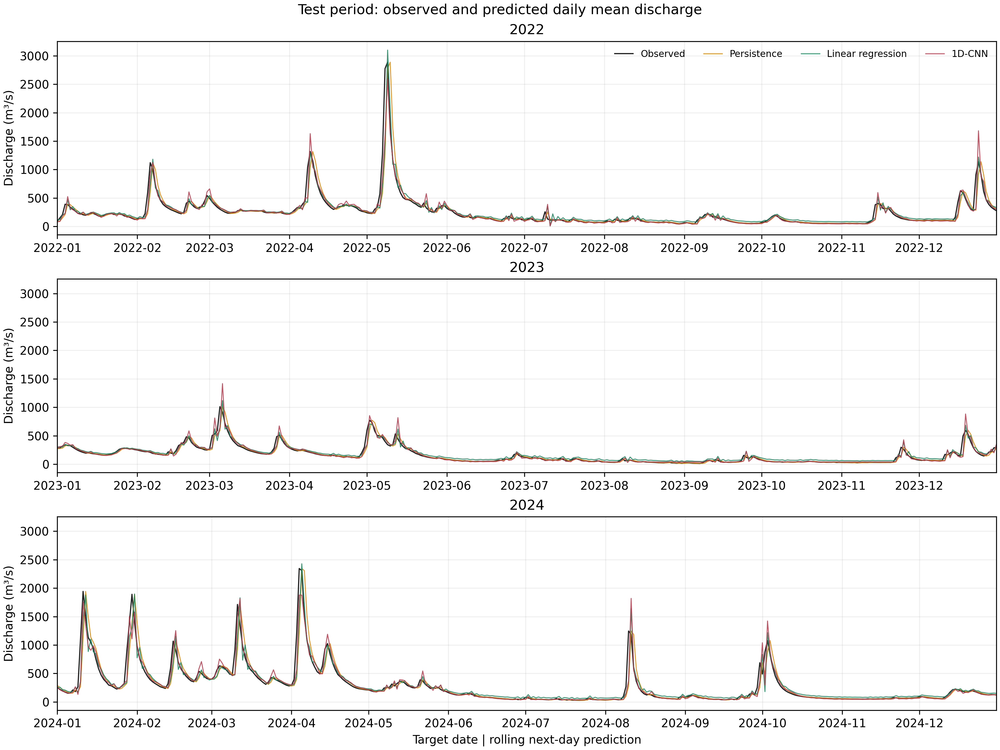

# 河流下一日流量预测

使用过去连续 **7 天日均流量预测下一天**，比较持续性预测、线性回归与小型 1D-CNN。本仓库提供原始数据档案、样本、训练代码、五次训练的模型权重、逐日预测和结果图，作为璞玉计划结题报告的配套材料。

## 实验设计

- 数据：USGS 01646500（Potomac River near Washington, DC），2010—2024 年，共 5479 天；参数 `00060`，统计量 `00003`。
- 单位：从 ft³/s 乘以 `0.028316846592` 换算为 m³/s。
- 输入：`q_lag7_m3_s` 至 `q_lag1_m3_s`，从最早到最近一天；目标为 `target_m3_s`。
- 训练：2010—2019 年，3617 个样本；验证：2020—2021 年，731 个；测试：2022—2024 年，1096 个。
- 标准化仅使用训练期有效日值。按目标日期划分，逐日滚动一步预测，测试期间不更新模型。
- 保留 Approved 的 ESTIMATED / REVISED 记录；输入或目标包含 6 天特殊质量标记的样本均排除。规则见 [数据说明](docs/DATA.md)。

## 已完成的结果

五个固定种子为 42、0、1、2、3；每次按验证损失选择模型。以下为同一组 1096 个测试日上的指标，CNN 汇总为均值 ± 样本标准差（ddof=1）。

| 方法 | MAE（m³/s） | RMSE（m³/s） | NSE |
|---|---:|---:|---:|
| 持续性预测 | 45.4011 | 127.3575 | 0.800457 |
| 线性回归 | 50.1210 | 104.7544 | 0.865001 |
| 1D-CNN（5 次） | 37.2391 ± 1.9843 | 97.7586 ± 1.3238 | 0.882413 ± 0.003183 |

完整表格见 [五次实验汇总](outputs/20261030T014752_stability_5seeds/stability_summary.md)。标准差表示固定测试期下的训练随机性；本研究范围为单站历史数据的一步预测。

沿用首次种子 42 作为示例曲线：



## 快速使用

下载仓库 ZIP 并解压，或使用 Git 克隆。在解压后的仓库根目录打开 PowerShell。原实验环境为 **Windows x64、Python 3.9.13、CPU**，依赖锁定于 `requirements-lock.txt`。

```powershell
py -3.9 -m venv .venv
& .\.venv\Scripts\python.exe -m pip install -r requirements-lock.txt --extra-index-url https://download.pytorch.org/whl/cpu
& .\.venv\Scripts\python.exe -B .\scripts\verify_results.py
```

最后一条命令只核验已保存的数据、模型和指标，无需重新下载数据或重新训练。

重新检查原始数据并构建样本：

```powershell
& .\.venv\Scripts\python.exe -B .\scripts\audit_data.py
& .\.venv\Scripts\python.exe -B .\scripts\prepare_samples.py
```

运行单次对比（默认种子 42）：

```powershell
& .\.venv\Scripts\python.exe -B -u .\scripts\run_experiment.py --seed 42
```

从头训练全部五个种子并汇总：

```powershell
& .\.venv\Scripts\python.exe -B -u .\scripts\run_stability.py
```

每次训练创建新的时间戳目录。详细流程与发布版改动见 [复现说明](docs/REPRODUCIBILITY.md)。

## 文件导航

| 路径 | 内容 |
|---|---|
| `scripts/` | 数据检查、样本准备、训练、五种子汇总和已保存结果核验 |
| `data/raw/20261029T103540Z/` | USGS 下载原文、来源查询和 SHA-256 |
| `data/processed/` | 完整逐日序列及质量标记 |
| `data/model/` | 三个分区样本、标准化参数、逐日可用状态 |
| `outputs/` | 五次原实验和一次汇总，含权重、配置、逐日预测和图表 |
| `reports/` | 数据与样本准备摘要、质量标记清单 |
| `docs/` | 数据来源、复现流程及发布文件校验清单 |

## 引用与使用

配套结题报告可在附录“代码与结果获取”处引用本仓库地址。引用数据时请同时注明 USGS、站号 01646500、2010—2024 年日均流量和下载日期 2026-10-29，原始查询保存在 manifest 中。

本次发布暂未指定代码开源许可证；公开供查看与核验，后续授权安排由作者确定。USGS 数据的来源与使用说明见 `docs/DATA.md`。
